# 癌醫伴你同行｜R7 全片腳本檢核稿

詠晴把工作期限和人生願望都排進本子。確診後，她撕掉那頁願望，把婚禮取消。阿澤撿回紙頁，卻一直沒告訴她。直到她翻見藍筆留下的承諾，兩人才問出當時沒說出口的話。治療中記下的症狀、想要孩子的願望，都成為她和醫療團隊能談的事。六年後，一位新病友把最擔心的工作問題寫下來，自己帶進診間。

說明：S03 進入回憶，S45 的「六年後」從小禾出生起算。S03 舊圖時間字樣待同步。醫療台詞、署名及片尾文字待院方確認。

## S01

女孩先把紙壓在膝上，再捏住右上角；拍到紙纖維被拉開才接下一鏡。

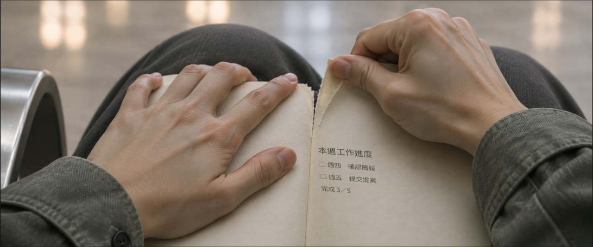

無台詞。

## S02

承接上一格紙角的位置。粉色袖口從左側入鏡，詠晴伸右手按住女孩的手。先看撕紙停下，再聽到她輕聲開口。以連續動作拍完。

詠晴（畫外對白）：「先別撕。」

## S03

雨聲先入，黑底片名「癌醫伴你同行」淡出，進入詠晴確診前的辦公室。此處移除「六年前」以銜接 S45b；現有字卡待同步。

無台詞。

## S04

從螢幕移到她握筆的手。旁白像她回想那晚，第一句輕一點；敲鍵盤的節奏一路帶到月曆。

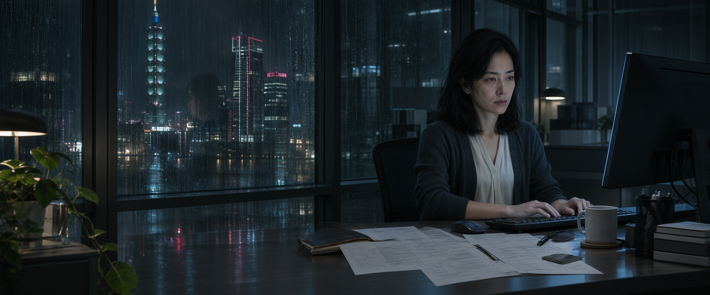

詠晴（旁白）：「我是一個自律的人。」

## S05

讓旁白最後的「待辦事項」落在勾完一格的動作上。她闔筆才切門口，門外雨聲先進。

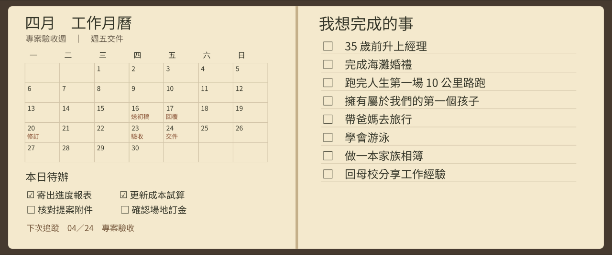

詠晴（旁白）：「人生的大小事，我都要規劃進度，追上 KPI，完成每個待辦事項。」

## S06a

只拍入口掛鉤：阿澤脫下唯一一件雨衣，袖口滴水，再拿起宵夜袋。袋子的提把連到下一鏡。

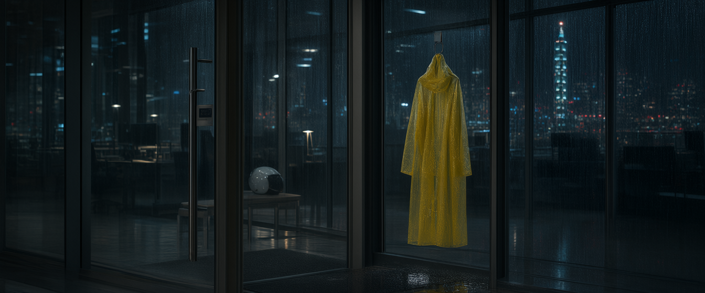

無台詞。

## S06b

他穿乾的深藍外套走到桌旁，宵夜落桌才說話。讓她的目光仍留在五月行程上；環境雨聲在人聲下方。

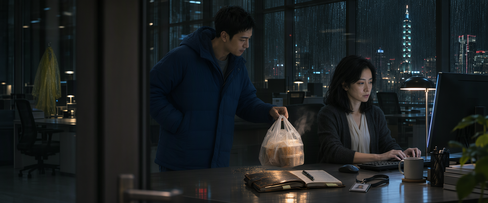

阿澤（現場對白）：「麵要糊了。」
詠晴（現場對白）：「你先看一下。明年五月，福隆，我訂到了。」

## S06c

從上一鏡宵夜袋已落桌的狀態接起，免去第二次送餐。說到婚期他才探頭看月曆，聽完她的回答才伸小指。

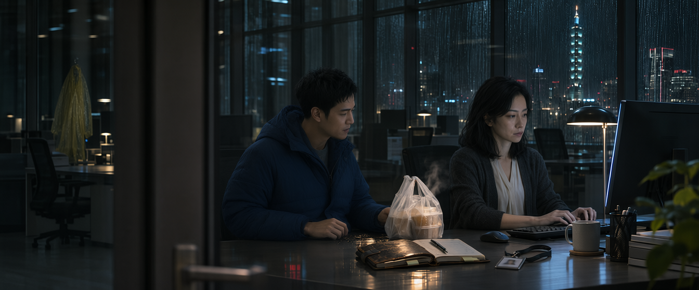

阿澤（現場對白）：「連我們結婚，妳都排進去了喔？」
詠晴（現場對白）：「沒把事情排進進度，我會很難受。」

## S07

兩個前臂各自連回人物；他伸右小指，她停下打字再伸左手。分開後讓她收回的手帶到下一鏡。

阿澤（畫外對白）：「那，先留十分鐘給我吃飯？打勾勾。」

## S08

先看宵夜還在、人已走。她伸懶腰時摸到硬塊，手再回到同一處確認。環境聲降下後才進貼近耳邊的旁白。

詠晴（旁白）：「那天晚上，我摸到一個硬塊。隔天，我就掛了號。」

## S09a

探頭緩慢滑動，螢幕內灰階組織隨角度改變，探頭停、切面停。

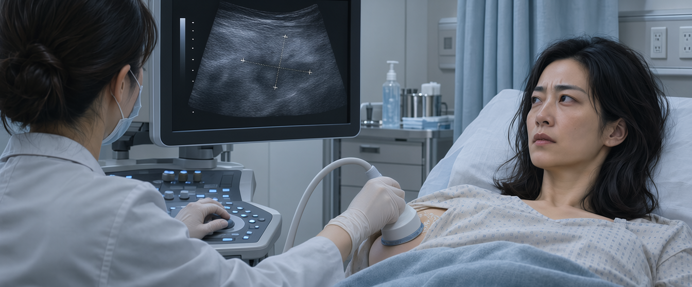

無台詞。

## S09b

約一秒推向同一位詠晴的瞳孔。

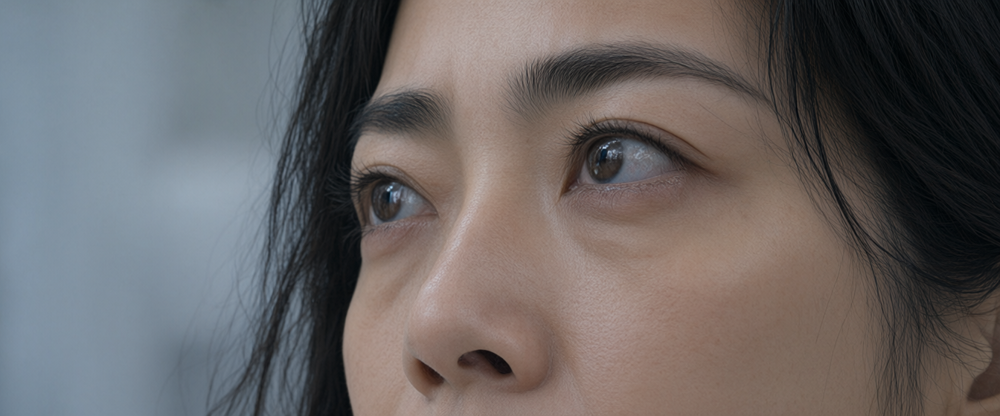

無台詞。

## S09c

停黑半秒。

無台詞。

## S10a

王醫師開口，病人只聽。

王醫師（現場對白）：「何小姐，切片確認是浸潤性乳癌。目前初步評估是第二期。」

## S10b

只讓王醫師男聲自畫外接續；詠晴閉口看他，聽到「妳」才握緊本子。場面說明留在畫面指令。

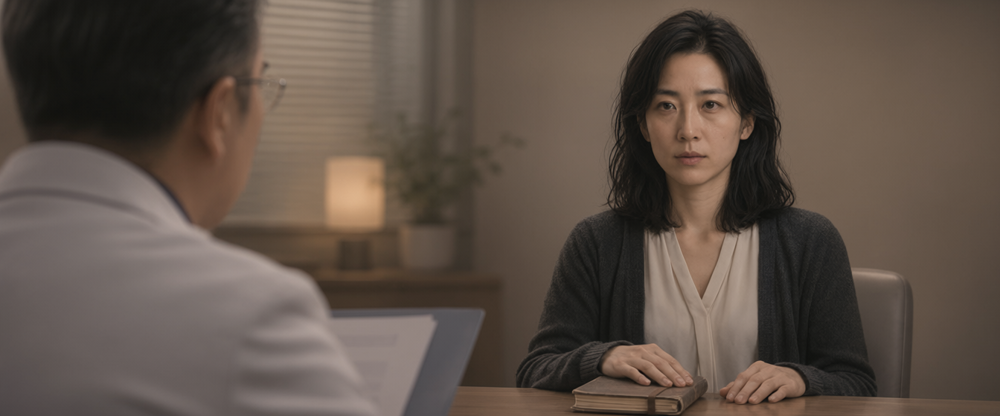

王醫師（畫外對白）：「我們會依妳的需求，量身訂做治療計畫。」

## S11

在婚禮與孩子兩行反覆來回劃，保留原字。

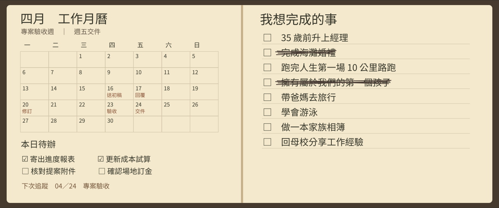

無台詞。

## S12

垃圾桶靠畫面右側，保留左側她走過來的空間。此鏡劇本無台詞：留紙團落桶聲，先核對上一句是否被切掉。

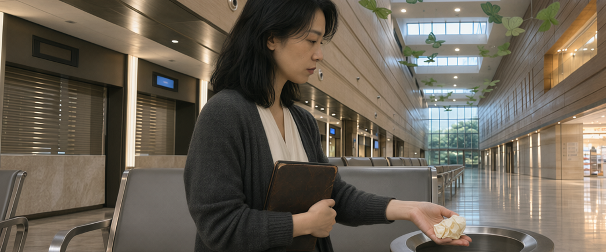

無台詞。

## S13

手機亮起時先看清詠晴側臉和開襟外套，再順她視線下移到「來電：阿澤」。回拍時沿用同一側。

無台詞。

## S14a

餐桌便當未拆，詠晴把診斷說出口。

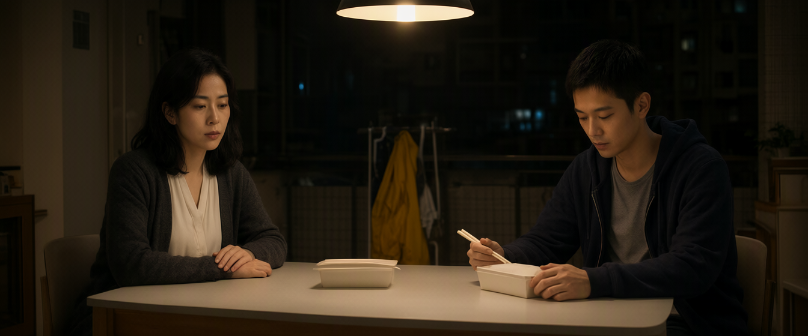

詠晴（現場對白）：「第二期。要開刀，之後可能要化療。」

## S14b

她把取消婚禮說得很快，像在交辦。說完還握著筷子等他反對；他的「好」等她抬眼才出來。

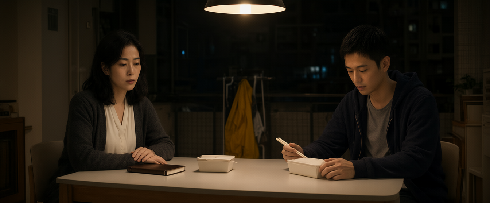

詠晴（現場對白）：「婚禮先取消。訂金我處理，你再跟爸媽說。」
阿澤（現場對白）：「……好。」

## S15

留在沒拆的便當上，椅腳聲接到關門聲。詠晴旁白走獨立聲軌，畫面中的人都不開口。

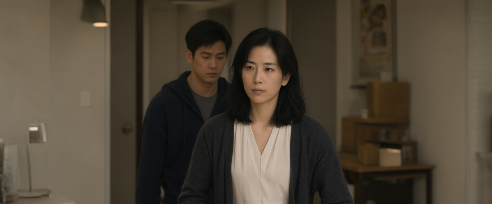

詠晴（旁白）：「我以為他會問我一句。結果，那天我們就說到這裡。」

## S16a

先見候診空椅。佳芸走到椅旁停步，等詠晴挪開包包才坐下。

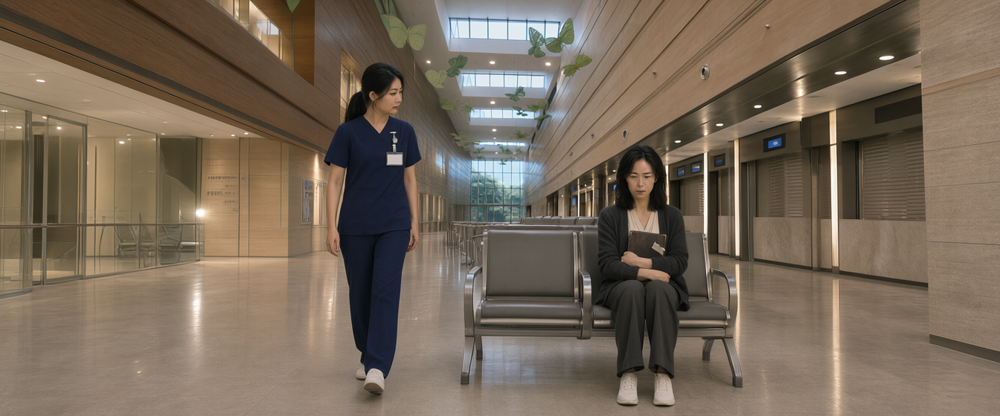

陳佳芸（現場對白）：「我可以坐這裡嗎？」

## S16b

詠晴闔本子時翹起的殘邊勾住袖口。佳芸伸手又收回，先問能不能看。兩人各說各的句子，停頓留給詠晴決定要不要回答。

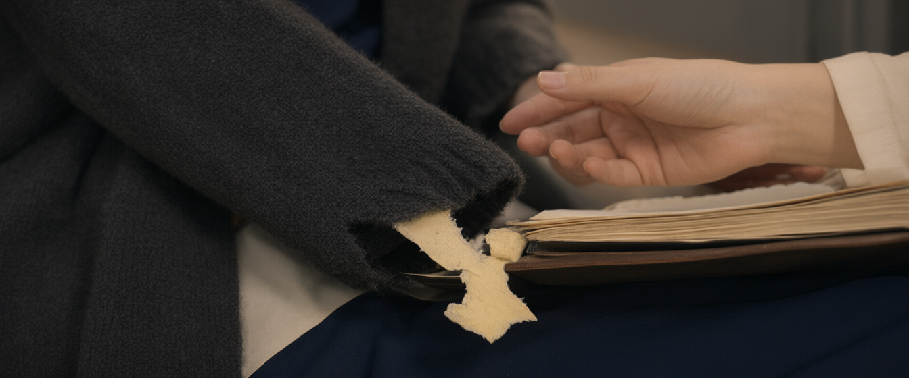

陳佳芸（現場對白）：「紙邊勾到了。要我幫妳嗎？」
詠晴（現場對白）：「我自己撕的。那一頁……用不到了。」
陳佳芸（現場對白）：「好。上面如果有妳還惦記的事，等一下也可以問醫師。」

## S17

門響時王醫師短暫看向門口，再把話說完。只錄明列的醫師台詞，動作指令保持無聲。

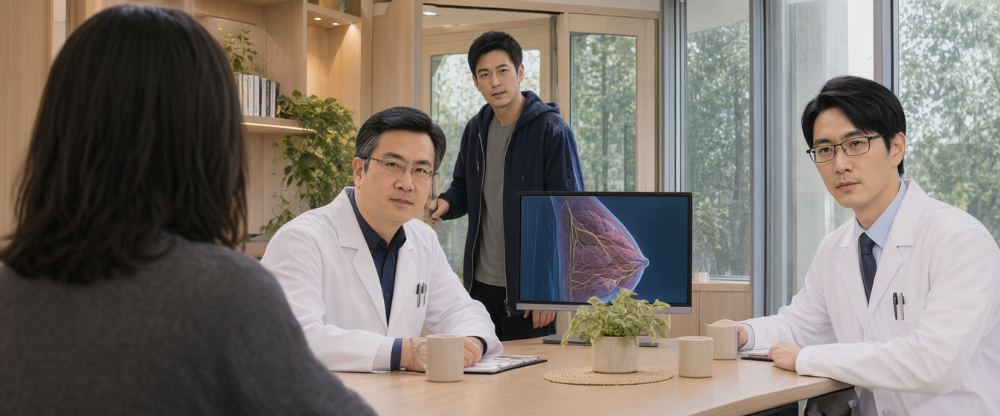

王醫師（現場對白）：「目前可以考慮乳房保留手術，並做前哨淋巴結切片。」

## S18a

接回王醫師說完「前哨淋巴結切片」後的停頓，再由林醫師開口；別把醫療詞切在換鏡處。

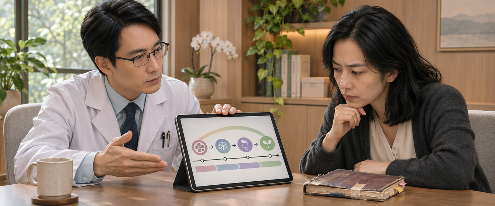

林醫師（現場對白）：「要不要化療，要看術後評估。如果需要，化療可能影響生育。開始之前，可以先和生殖醫學團隊談。」

## S18b

聽到「生育」，阿澤看一眼願望本，抽回手才退椅離開。詠晴的視線跟著他到門口。

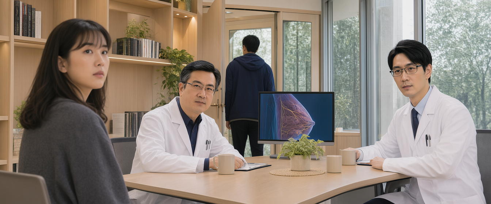

阿澤（現場對白）：「對不起，我出去一下。」

## S18c

門慢慢闔上，座椅空著；林醫師先問，她吸一口氣才回答。兩人的現場聲分開。

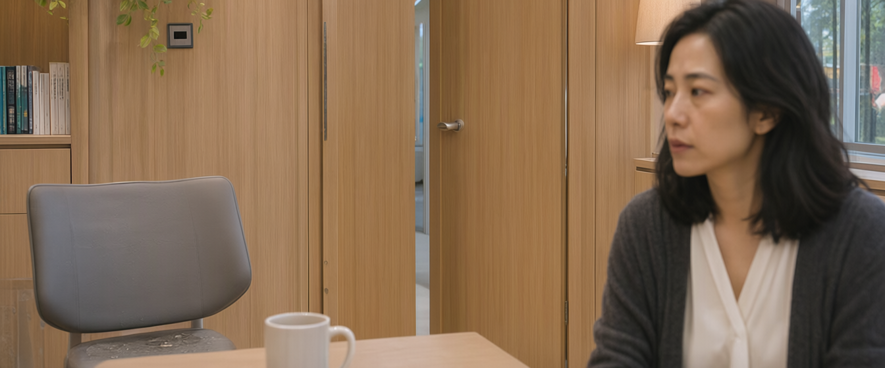

林醫師（畫外對白）：「要等他嗎？」
詠晴（畫外對白）：「不用。醫師，請繼續。」

## S19a

術後數週，護理師核對身分、準備管路。

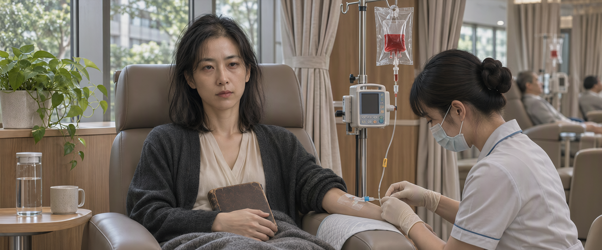

化療護理師（現場對白）：「手先放鬆。有不舒服就跟我說。」

## S19b

護理師低頭，視線向空陪病椅移動。

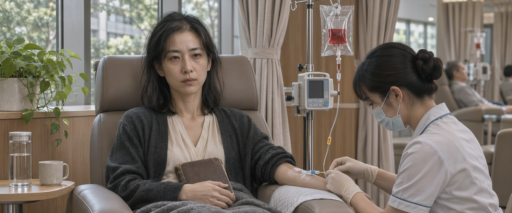

詠晴（旁白）：「手術後，我開始化療。旁邊那張椅子，有時只放著我的包包。」

## S20

阿澤深夜戴著毛帽進門，按住帽沿。

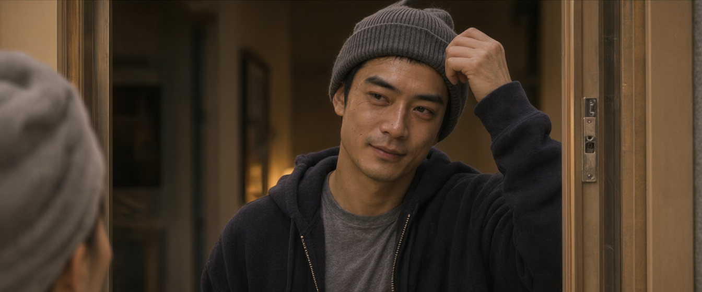

詠晴（現場對白）：「又加班？」
阿澤（現場對白）：「……嗯。」

## S21

浴室水聲停下，詠晴低頭看梳子。

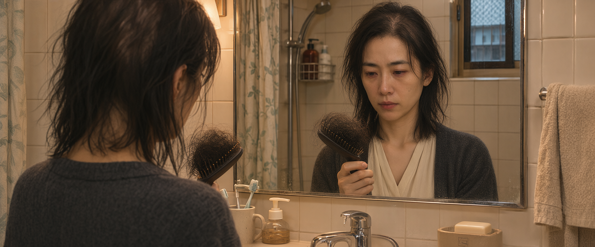

詠晴（旁白）：「頭髮開始掉的那天，我洗了好久的梳子。」

## S22

App 文字由後製排版「症狀紀錄」「第二天」「喝水時噁心」。拇指停在儲存鍵，對應 S36a 護理師查看的這一筆。

無台詞。

## S23

分手字條逐字出現，游標停在句點。

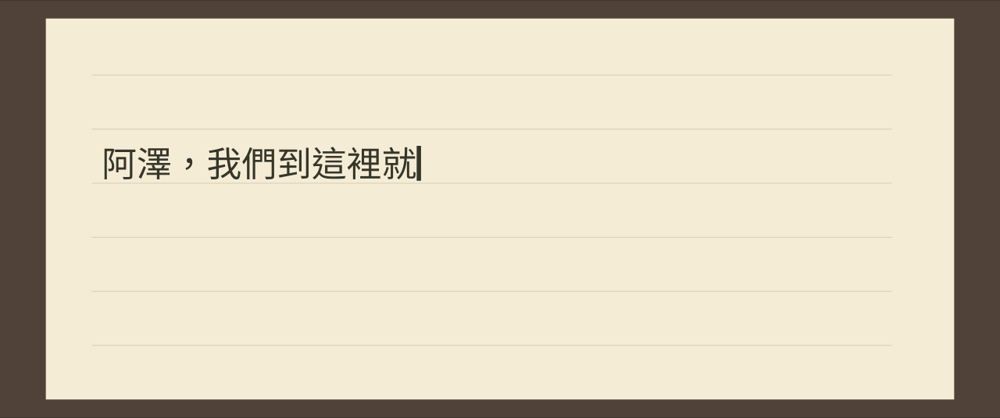

無台詞。

## S24

保留上鏡已填寫的四月月曆和待辦。她往回翻，指腹碰到黏歪的膠帶才停；用紙張磨擦聲回到走廊。

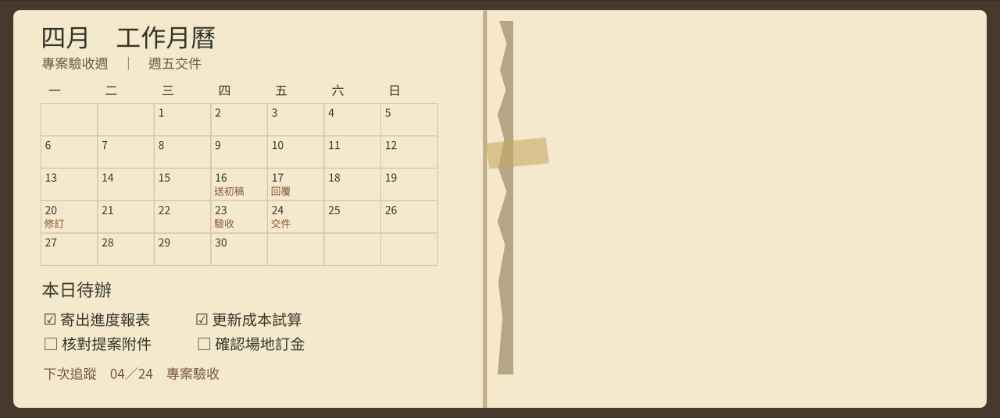

無台詞。

## S25

用柱邊過肩中景；男主只占前景一側，視線與手機方向都指向她離開的背影。保留桶與整排座椅。

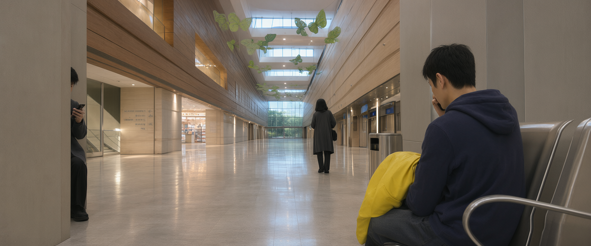

無台詞。

## S26a

先承接同一根柱子、椅列與桶的位置。他從柱邊走近才切手伸入桶內。

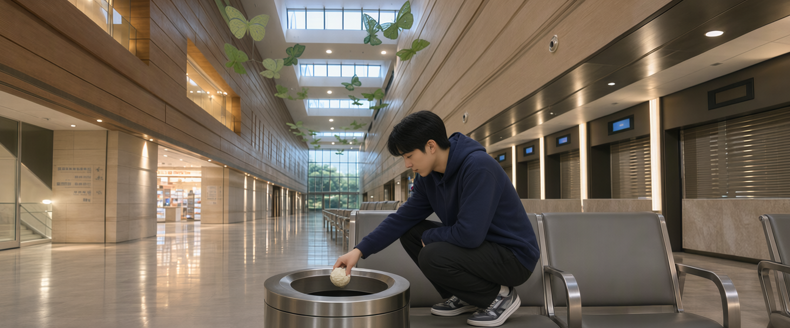

無台詞。

## S26b

攤開皺紙，婚禮與孩子留有重筆。

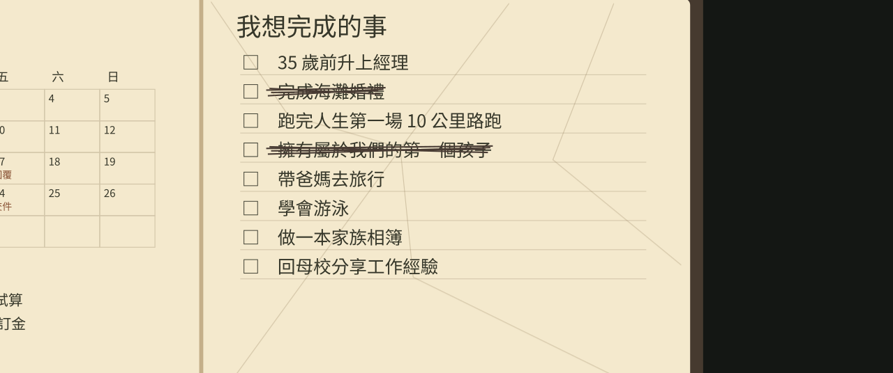

無台詞。

## S27

抬起棉布露出熨平的那張願望頁。

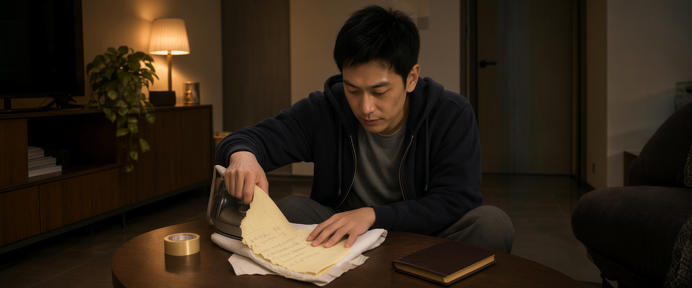

無台詞。

## S28

阿澤在候診區叫住出來拿資料的個管師。

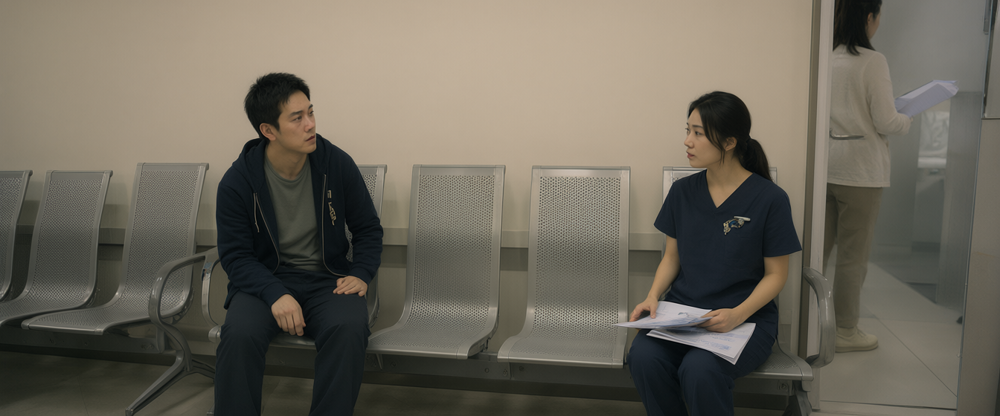

阿澤（現場對白）：「她還好嗎？」
陳佳芸（現場對白）：「她還在跟醫師談。你要一起進去嗎？」

## S29a

他想起取消婚禮的回答。

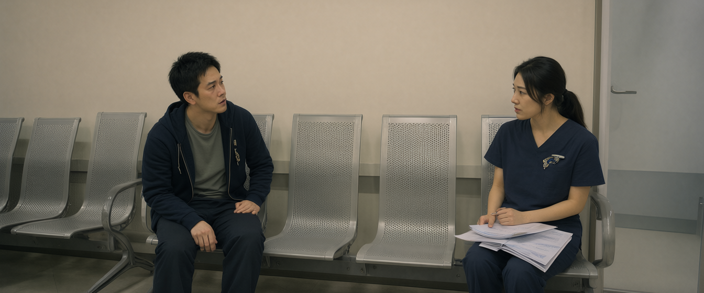

阿澤（現場對白）：「她說取消，我就說好。我是不是很爛。」
陳佳芸（現場對白）：「你尊重她的決定，那不是爛。」

## S29b

阿澤說到「報告」時低頭，佳芸聽完才答。醫護與家屬聲軌依角色分配，切反應鏡時保持同一人說完。

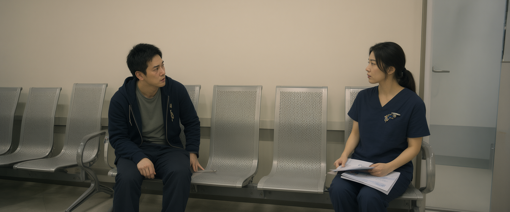

阿澤（現場對白）：「我連剛才那份報告都聽不懂。進去能幹嘛？」
陳佳芸（現場對白）：「剛才你一出去，她就看著門。你可以先回去，坐在她旁邊。」

## S30a

師傅在旁指著梳套，阿澤先拿自己試。

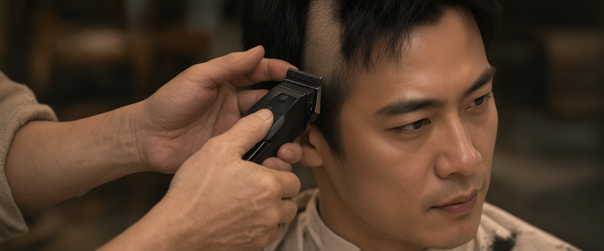

阿澤（畫外對白）：「她說，等頭髮再掉多一點，就想剪短。我怕到時候手忙腳亂。」
理髮師傅（畫外對白）：「先問她想留多長。你今天要試，先裝這個梳套。」

## S30b

阿澤摸到剛推短的一側，師傅收起電剪。理髮過程留在局部近景，摘帽後接完整光頭。

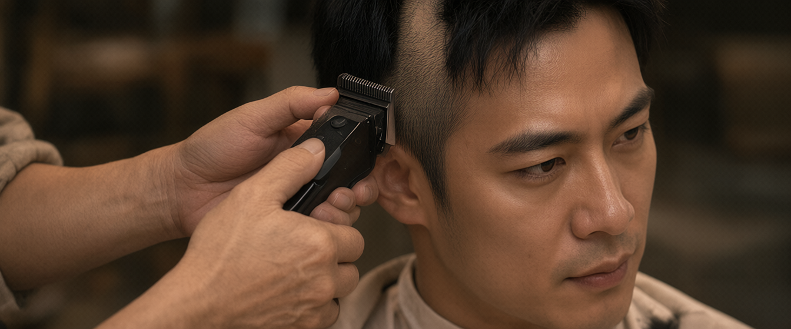

阿澤（畫外對白）：「這樣她還敢讓我剪嗎？」
理髮師傅（畫外對白）：「到時候讓她決定。你先把手練穩。」

## S31

紙黏回本子，八項願望下面新增藍筆承諾。

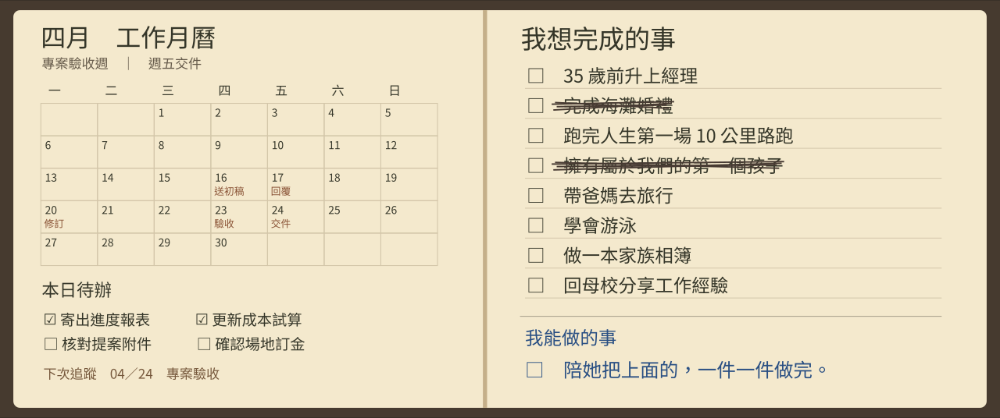

無台詞。

## S32

先響鑰匙，詠晴的視線離開藍字。她抬頭時他已停在門內；兩人都先看看本子，再談帽子。

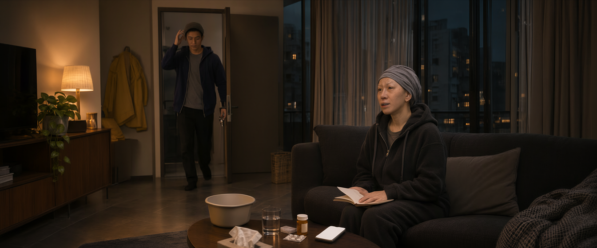

詠晴（現場對白）：「拿下來給我看一下。」

## S33a

帽子拿下，露出已全部剃光的頭。詠晴忍不住笑，阿澤摸摸後腦，才看向她。

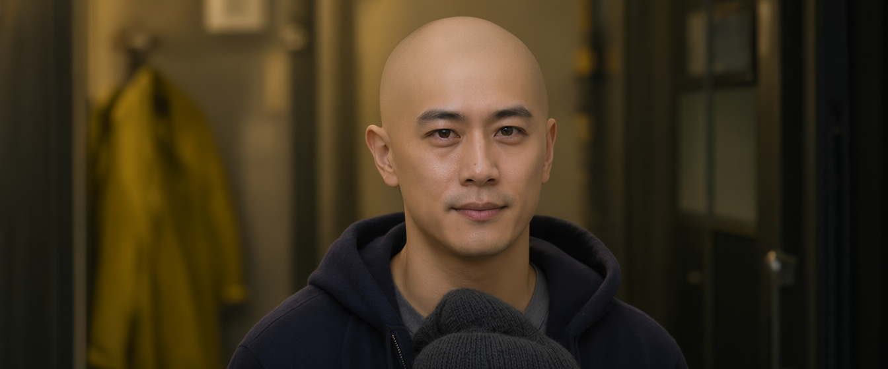

詠晴（現場對白）：「你真的把頭髮都剃了喔？」
阿澤（現場對白）：「嗯。摸起來還有點不習慣。」

## S33b

沿用摘帽後同一光頭。讓她把「婚禮」問出口；他捏住帽沿，答到一半停一下才說出真正的擔心。

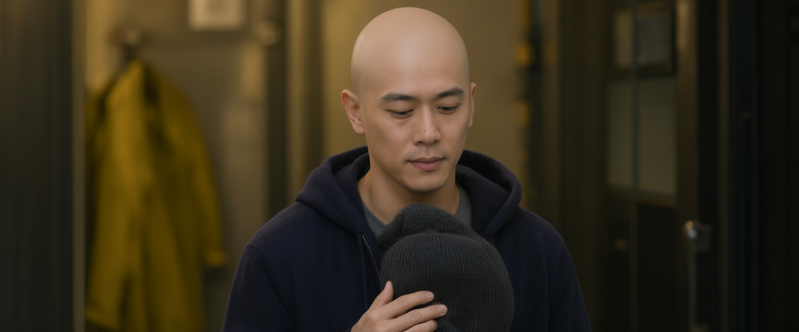

詠晴（畫外對白）：「我說婚禮取消，你真的只回我一個好。」
阿澤（現場對白）：「我那時候如果多講一句……可能就要妳反過來哄我了。」

## S34

延續阿澤光頭與詠晴稀疏髮際。她把電剪遞過去就是同意，取消連續點頭。

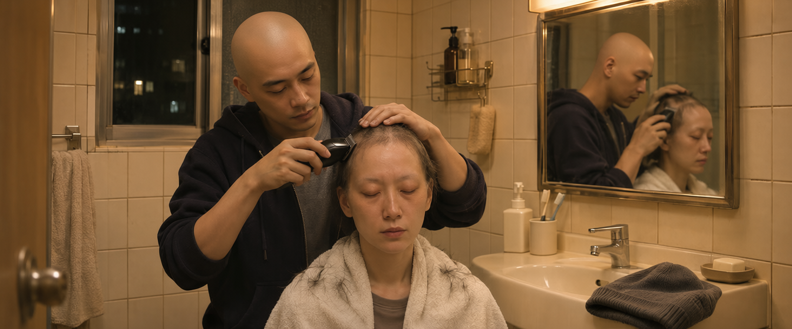

詠晴（現場對白）：「幫我剪短一點。」
阿澤（現場對白）：「這個長度？」
詠晴（現場對白）：「嗯，就這樣。」

## S35

電剪停下，兩人聽見彼此的呼吸。她摸了摸後腦才問下次化療；勾指是聽到回答後的小動作。

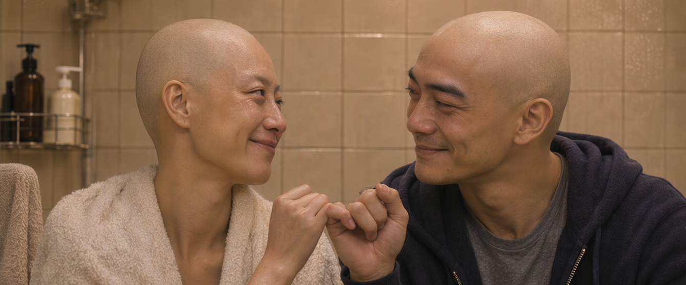

詠晴（現場對白）：「下次化療，陪我去，好不好？」
阿澤（現場對白）：「好。我去接妳。」
詠晴（現場對白）：「說好了喔。」

## S36a

化療期造型比對 S35，詠晴頭巾下及耳側不露長髮；阿澤也延續剃髮狀態。她把最不舒服的那天指給護理師看。

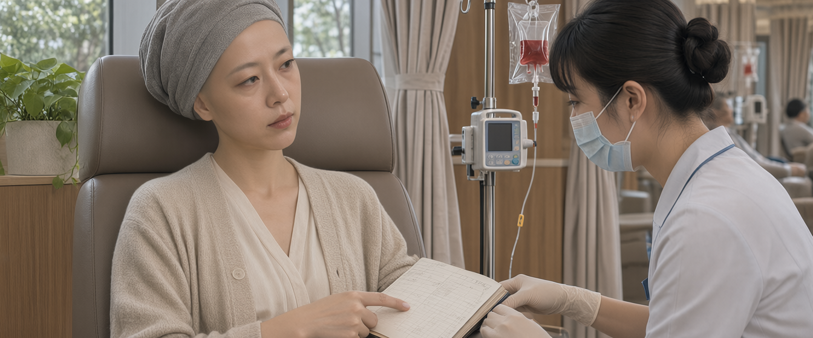

化療護理師（現場對白）：「上次回去，哪一天最不舒服？」
詠晴（現場對白）：「第二天，連喝水都想吐。」
化療護理師（現場對白）：「這天我幫妳記下來，等一下跟醫師一起看。」

## S36b

護理師離開，詠晴替睡著的阿澤蓋毯子。

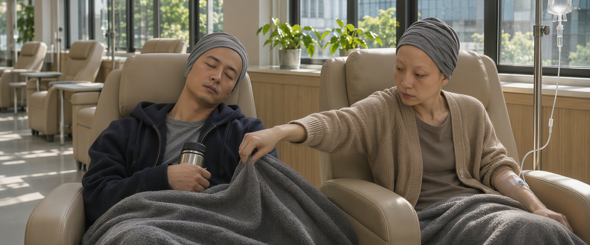

無台詞。

## S37

側拍河濱慢跑，兩人步頻不同、腳底自然承重，放慢來喝水。

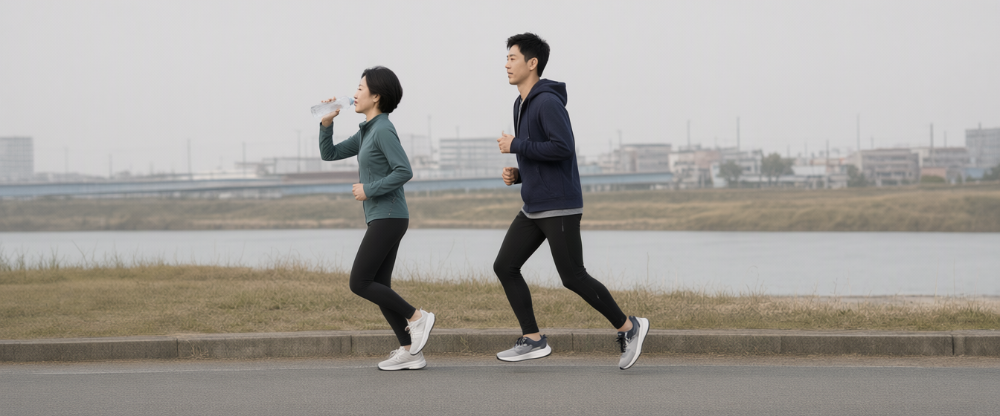

詠晴（現場對白）：「走一下？」

## S38

沿用 S37 兩位演員、衣著及跑向；用側面全身看到腳落地、重心前移，再切鞋越線。過線先喘氣，才看對方。

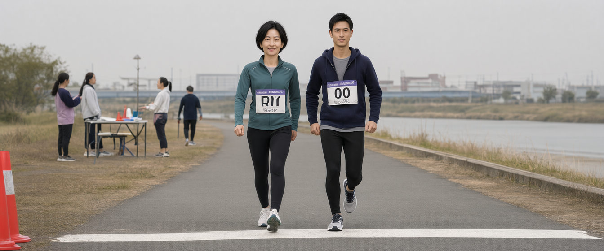

無台詞。

## S39

第三項從空格到一個勾，筆尖帶出墨跡。

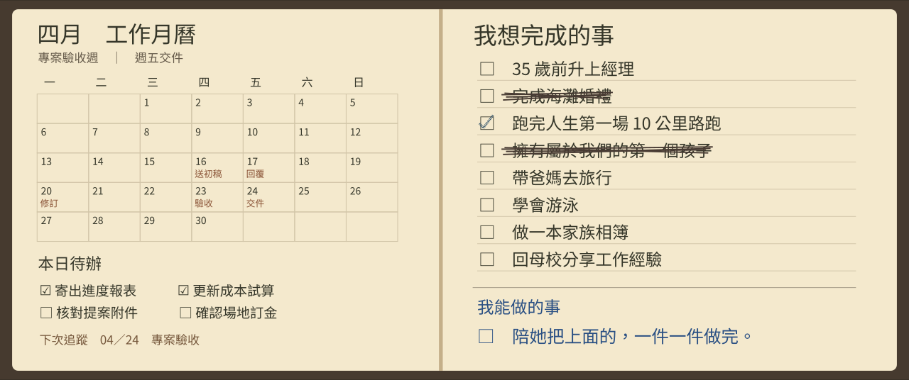

無台詞。

## S40a

海灘婚禮，阿澤替詠晴撥頭髮，兩張臉同焦。

無台詞。

## S40b

王醫師放下手、林醫師微笑、佳芸拿面紙，三人不同步。

無台詞。

## S41

在留著舊刪線的婚禮格補勾。

無台詞。

## S42a

備孕前她把願望本轉向林醫師。

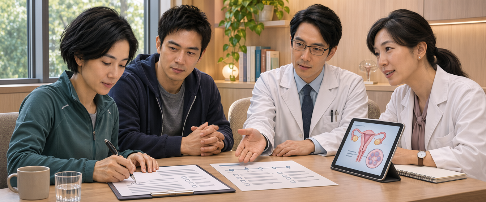

詠晴（現場對白）：「這一項，我還是很想要。我現在可以開始準備嗎？」

## S42b

醫師看向她指的願望，回答完才離開診間。

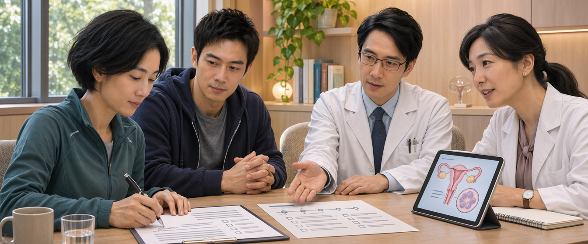

林醫師（現場對白）：「我們先一起看妳現在的治療和用藥，再跟生殖醫學科討論時機。藥先照原來的方式用，有要調整，我們會跟妳說。」

## S42c

詠晴記下問題，闔上本子。

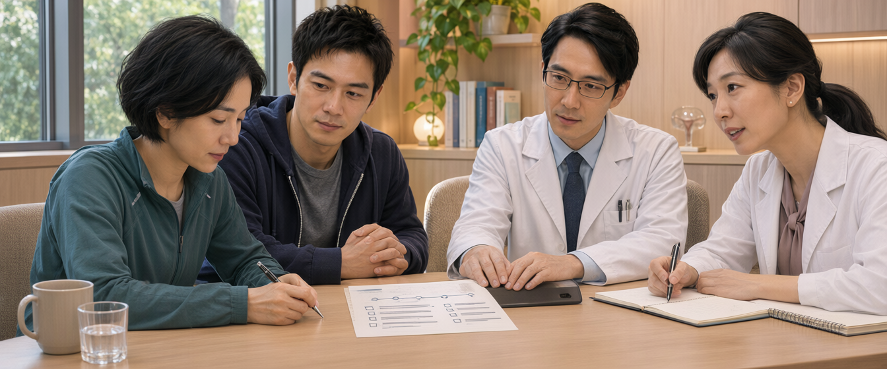

詠晴（現場對白）：「好，那我把想問的先寫下來。」

## S42d

時日過去，另一天的產檢，只有室內環境聲。

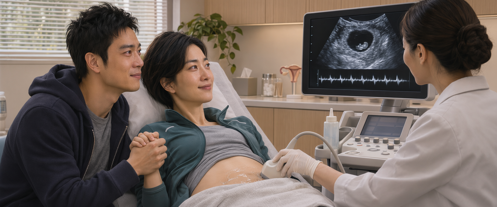

無台詞。

## S43

阿澤輕觸小禾的包巾。

無台詞。

## S44

三個勾，升經理的旁邊寫不急。

無台詞。

## S45a

收光停黑一秒。

無台詞。

## S45b

黑幕字卡「六年後」。以小禾出生為時間起點，轉至一家三口回院。

無台詞。

## S45c

希望光塔下，院內導覽螢幕亮起。

無台詞。

## S46

從小禾出生算起六年後。六歲的小禾自己走在父母中間，一家三口沿中庭走向候診區。

無台詞。

## S47a

先留給女孩一次完整的失控：紙角皺了、肩膀縮起、紙巾掉下。詠晴聽到聲音才從走廊另一端回頭。

無台詞。

## S47b

詠晴撿起紙巾，在女孩看得到的地方詢問。

詠晴（現場對白）：「我可以坐這裡嗎？」

## S47c

粉色袖口輕輕按住要撕紙的手。

詠晴（畫外對白）：「先別撕。」

## S48a

回接 S02 同一組手與袖口，從詠晴右手覆住女孩手背一路抬到女孩的臉；她看對方坐穩後才開口。

新病友（現場對白）：「下個禮拜要回來，我連要問什麼都不知道。」

## S48b

詠晴等她說完，把筆遞給她。

詠晴（現場對白）：「我第一次來也這樣。妳現在最想問哪件事？」
新病友（現場對白）：「治療開始以後，我還能不能上班？」

## S48c

女孩把寫好的問題轉向佳芸。佳芸等她放開紙角，讀完才接話，最後讓女孩自己把本子拿回去。

陳佳芸（現場對白）：「我是佳芸，這裡的個管師。我可以看一下嗎？」
新病友（現場對白）：「我把剛才那個問題寫下來了。」
陳佳芸（現場對白）：「好，等一下見到醫師，我們先問工作怎麼排。」

## S49

阿澤停在柱旁，小禾已走向媽媽。男孩兩手各拿一杯咖啡。等他看向女孩，阿澤才指指她旁邊的空位。

新病友伴侶（現場對白）：「我怕走過去，她又要跟我說她沒事。」
阿澤（現場對白）：「你先把咖啡拿給她。她剛剛一直在找你。」

## S50

孩子站到女孩膝前，伸出小指。

小禾（現場對白）：「借妳勾一下。」

## S51

同側貼近雙手，勾住，灰椅與灰綠袖口仍在。

無台詞。

## S52a

阿澤扣上筆蓋。

詠晴（畫外對白）：「這個，今天要勾嗎？」
阿澤（畫外對白）：「先留著。」

## S52b

留在藍色承諾前的空格。

無台詞。

## S52c

女孩把寫好的那頁拿在自己手上。佳芸替她留門，等她走到身邊才一起進去；用這個動作接片尾。

無台詞。

## S53

片尾。把你在意的生活，帶進診間。癌醫伴你同行。臺大癌醫。

無台詞。

## 本次成片採用的六鏡修訂

- S04　片頭先留一秒雨窗空景，再接詠晴在辦公桌前。
- S07　阿澤開玩笑，詠晴從月曆抬眼回應；用雙人中近景，雙手在畫外。
- S35　兩人說完約定後相視，肩膀放鬆，雙手在畫外。
- S37　先留約一秒三分之一的無人河濱，再接兩人跑步。
- S45c　先留一秒半希望光塔與中庭空景，再交代一家三口的位置。
- S51　小禾伸出小指，女孩先看孩子的手，再抬眼微笑；鏡頭移向女孩，兩人的手沒有交纏。
